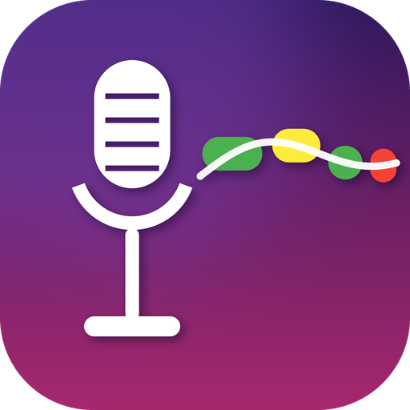
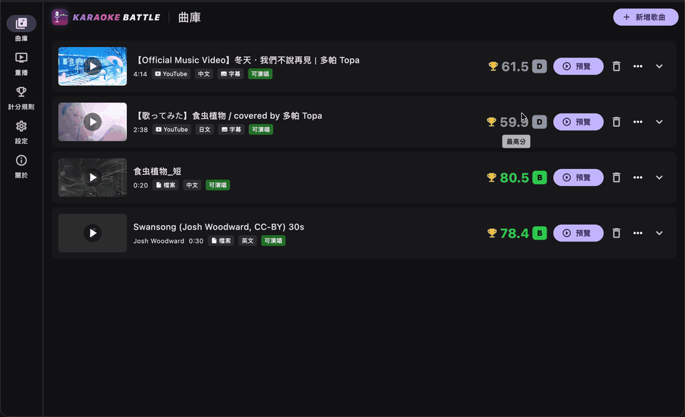
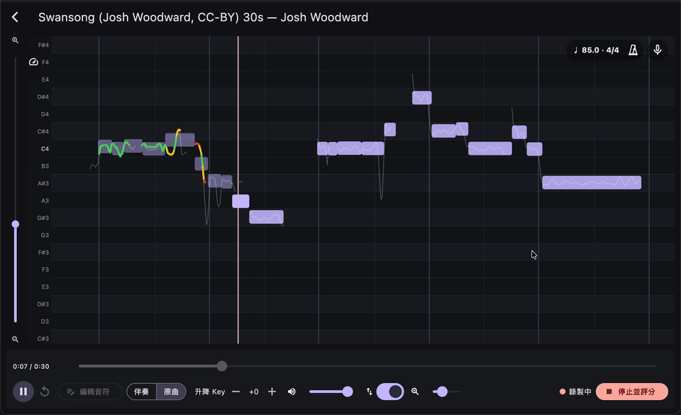
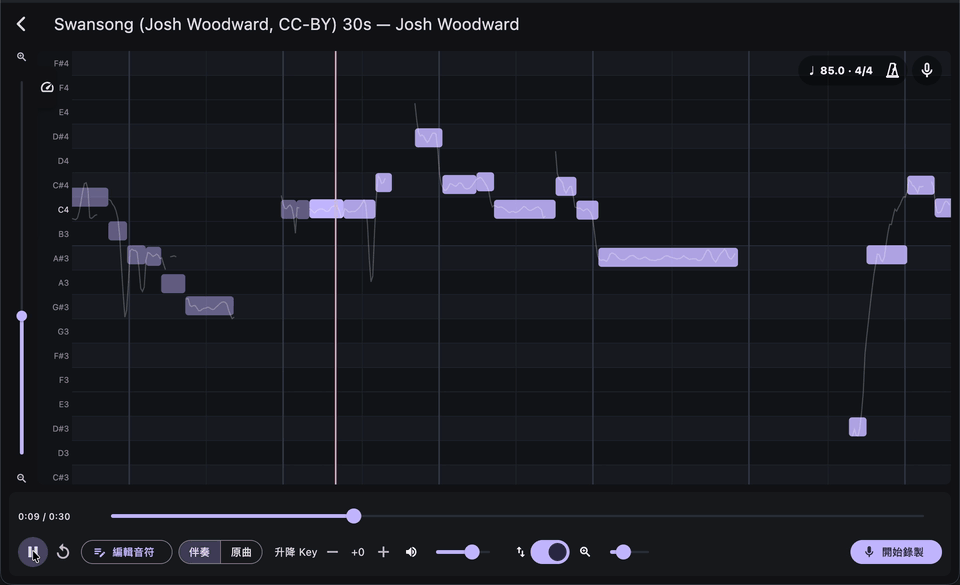
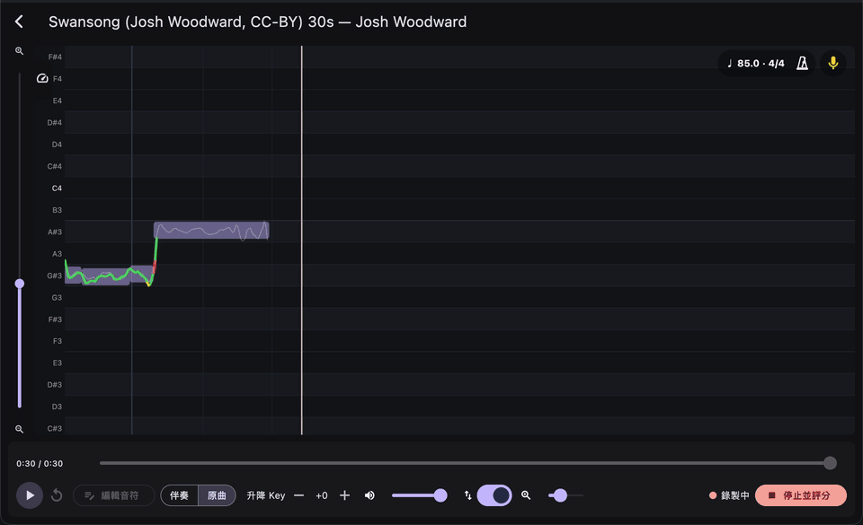
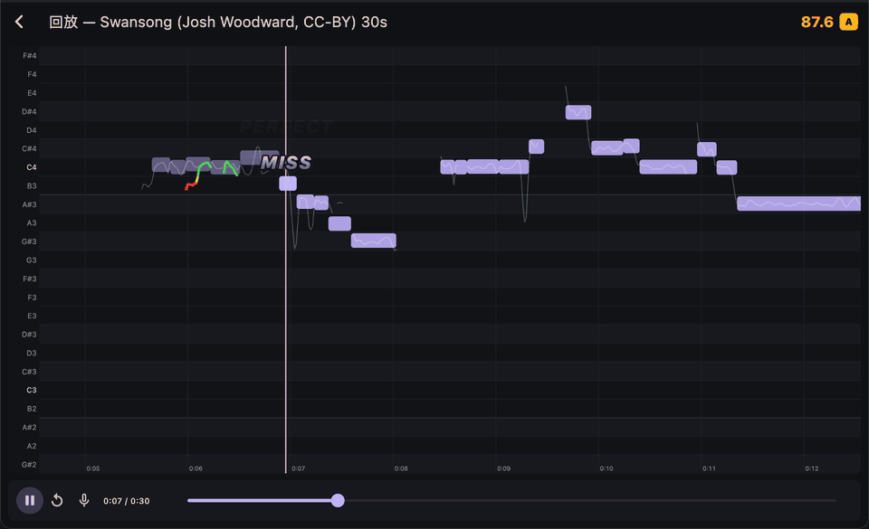
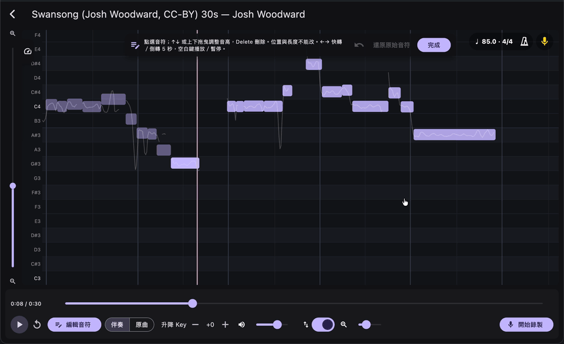

<p align="center">
  
</p>

<h1 align="center">Karaoke Battle</h1>

<p align="center">
  <a href="https://github.com/Hikari-Tsai/karaoke-battle/releases/latest/download/KaraokeBattle-macos-universal.dmg"></a>
  <a href="https://github.com/Hikari-Tsai/karaoke-battle/releases/latest/download/KaraokeBattle-windows-x64.zip"></a>
  <br>
  <a href="https://github.com/Hikari-Tsai/karaoke-battle/releases/latest"></a>
  <a href="https://github.com/Hikari-Tsai/karaoke-battle/actions/workflows/build.yml"></a>
  <a href="LICENSE"></a>
</p>

<p align="center"><a href="README.md">中文</a> · <b>English</b> · <a href="README.ja.md">日本語</a></p>

A karaoke scoring system for streamers. Paste a YouTube link or drop in an audio or video file, and the app
performs vocal separation, melody transcription and reference pitch extraction locally on your machine. While you
sing, a scrolling piano roll shows the reference melody alongside your live F0 curve; when you finish, you get
quantitative scores for pitch, rhythm, stability, vibrato, expression and long tone.

* macOS (Universal, Apple Silicon + Intel) and Windows x64; a Flutter desktop app with a native C++ engine.
* All models are downloaded from Hugging Face `aaatmy/*` on first run and verified with SHA-256; the installer does not bundle any models.
* On Windows, CUDA is the primary acceleration path (detected automatically; if anything is missing, the app prompts you to install the driver and downloads the CUDA runtime),
  with DirectML and CPU as fallbacks. macOS uses the CPU (some models try CoreML). Fallbacks do not affect scoring accuracy, only song preparation speed.

## Features for streamers

Every clip below was recorded from the running app (demo song: "Swansong" by Josh Woodward, CC BY). The GIFs have no sound.

### Turn any song into karaoke

Paste a YouTube link or drop in a media file. In the background the app separates the vocals, builds the accompaniment, and transcribes the melody notes and reference pitch; when it is done you can sing. You can queue several songs at once.

<p align="center"></p>

### See exactly which notes went off

A scrolling piano roll shows every note of the original singer, and your pitch is drawn live on top of it: green is on pitch, yellow is close, red is off. Viewers get it at a glance.

<p align="center"></p>

### Key shift and vocal return

Key moves the accompaniment and the reference notes together. The vocal return at the top right sends your voice to the headphones along with the music (and to the stream when OBS captures the app's audio), with an optional hall reverb.

<p align="center"></p>

### Scores and share cards

Right after you sing you get a 0–100 score on a scale close to DAM's Seimitsu Saiten, a rank from D to SSS and six sub-scores, and one click turns it into a share card for X, Instagram or Threads. Every take stays in the library, with your best score on top.

<p align="center"></p>

### Rhythm-game style replays

The replay pops PERFECT / GREAT / GOOD / MISS judgements at the playhead, rhythm-game style. Export a replay as a zip (the score data plus your vocal recording) and send it to a friend; they import it and watch your take.

<p align="center"></p>

### Fix notes by hand

Press "Edit notes" and drag a note up or down to fix it. While you drag, a sine tone plays the new pitch (not audible in the GIF). You can restore the original transcription at any time.

<p align="center"></p>

## Architecture

See [docs/ARCHITECTURE.md](docs/ARCHITECTURE.md), [docs/BACKENDS.md](docs/BACKENDS.md) and [docs/BUILD.md](docs/BUILD.md) for details.

| Layer | Contents |
| --- | --- |
| `app/` | Flutter UI: song library, song preparation pipeline, singing screen (scrolling MIDI + live F0), results, settings; Dart scoring module |
| `engine/` | C++17 engine (dart:ffi): dynamic loading of ONNX Runtime, MDX-Net separation, GAME transcription, SwiftF0 pitch, miniaudio real-time audio and playback clock, signalsmith-stretch key shifting |
| `scripts/` | Version manifests and download scripts for ORT, sidecars (yt-dlp / ffmpeg / deno) and the CUDA pack |
| `.github/workflows/` | CI packaging for macOS universal and Windows |

## Models

| Model | Purpose | Author | License |
| --- | --- | --- | --- |
| [aaatmy/game-large-onnx](https://huggingface.co/aaatmy/game-large-onnx) / [game-small-onnx](https://huggingface.co/aaatmy/game-small-onnx) | Vocals to MIDI (GAME 1.0 Large / Small) | Team OpenVPI | Weights CC BY-NC-SA 4.0 (non-commercial), code MIT |
| [aaatmy/uvr-mdx-net-onnx](https://huggingface.co/aaatmy/uvr-mdx-net-onnx) | Vocal separation, Kim_Vocal_2 | KimberleyJensen (distributed via UVR) | No license file; author's public permission statement |
| Same as above | Accompaniment separation, UVR-MDX-NET-Inst_HQ_4 | UVR core developers Anjok07, aufr33 | MIT (per UVR's statement) |
| [aaatmy/swift-f0-onnx](https://huggingface.co/aaatmy/swift-f0-onnx) | Real-time and offline F0 | Lars Nieradzik | MIT |
| [aaatmy/beat-this-onnx](https://huggingface.co/aaatmy/beat-this-onnx) | Beats, downbeats and BPM (beat grid, metronome) | CPJKU (Foscarin, Schlüter, Widmer) | MIT |
| [aaatmy/kuromoji-ipadic-pack](https://huggingface.co/aaatmy/kuromoji-ipadic-pack) | Romanization of Japanese lyrics (downloaded only when a song has Japanese lyrics) | kuromoji.js (Takuya Asano), mecab-ipadic (NAIST) | Apache-2.0, IPADIC terms |

All three mirrors are verbatim copies of the official upstream files (not retrained, quantized or re-exported), with only a manifest and SHA-256 hashes added.
The GAME weights are licensed for non-commercial use only, so use of the app as a whole is subject to those terms.

## Scoring

When you finish singing, the recorded F0 curve is aligned and compared with the original vocals (GAME notes plus a SwiftF0 reference curve), producing six sub-scores:
**pitch** (Raw Chroma Accuracy), **rhythm** (rhythm-game style PERFECT / GREAT / GOOD / MISS per note, with windows scaled by BPM), **stability**,
**vibrato**, **expression** (correlation of energy curves) and **long tone**. Their weighted total is mapped to a 0–100 score on a scale close to DAM 精密採点 (around 80 is typical, 90 and above is good), with a rank from D to SSS.

Three key design points: **notes an octave apart count as the same note** (singing an octave higher or lower is still correct), **global transposition is allowed**
(a single semitone offset for the whole song, estimated automatically), and **slides in the original vocals and GAME transcription errors are tolerated**: each frame's
target includes both the original singer's F0 curve and the GAME note pitch, and matching either one counts as correct, so you can follow the original's slides or sing the notes straight.
For the full alignment method, metric definitions, formulas and calibration results, see [docs/SCORING.en.md](docs/SCORING.en.md).

## Installation and usage

Download the DMG or zip from the badges above and install it. On macOS, the first time you launch it, right-click the app and choose "Open" (it is not notarized); on Windows, choose "Run anyway" in SmartScreen.
The first launch downloads the models (about 500 MB) and external tools; on Windows you can also choose to download the CUDA runtime.
After adding a song (a YouTube link or a dropped file), wait for song preparation to finish, then press "Preview" to open the singing screen. You can listen to the original track or the accompaniment and view the piano roll first; put on headphones and press "Start recording" to begin scoring. The headset button at the top right of the singing screen turns on the vocal return, which sends your voice to the output together with the music. The reverb button next to it switches a hall reverb on or off and sets its mix; replays use it too. Recording, scoring and exported replay files always use the dry voice.
For the full steps, data locations and FAQ, see [docs/INSTALL.md](docs/INSTALL.md) (Chinese).

## Building

```bash
# Engine (macOS, universal)
scripts/fetch_ort.sh
cmake -S engine -B engine/build -G Ninja -DCMAKE_BUILD_TYPE=Release
cmake --build engine/build -j

# App
cd app && flutter pub get && flutter run -d macos
```

In development mode, the app automatically looks for the engine in `engine/build/` and for ORT in `engine/third_party/onnxruntime/`.

## Acknowledgments

For full citation formats (including BibTeX) and each upstream project's requirements, see [docs/CITATIONS.md](docs/CITATIONS.md) (Chinese).

* **GAME 1.0 Small / Large** (melody transcription models) by **Team OpenVPI**,
  from [openvpi/GAME v1.0.3](https://github.com/openvpi/GAME/releases/tag/v1.0.3),
  licensed under [CC BY-NC-SA 4.0](https://creativecommons.org/licenses/by-nc-sa/4.0/).
  Models released by yqzhishen; data labeling provided by 挚彬Club, YQ之神, 小狼 and 幽寂. This app uses the official ONNX files without modification; it is not endorsed by openvpi.
* **Kim_Vocal_2** (vocal separation) by **KimberleyJensen**, trained independently and distributed via UVR. The upstream has no license file; it is used under the author's
  [public permission statement](https://github.com/KimberleyJensen/kmdx-net_music-source-separation/issues/3) (2026-10-02).
* **UVR-MDX-NET-Inst_HQ_4** (accompaniment separation) by **Ultimate Vocal Remover** core developers **Anjok07 and aufr33** (MIT, credited per UVR's attribution requirements).
* The MDX-Net architecture and training code come from **kuielab** (Choi et al., *TFC-TDF-U-Net*, ISMIR 2020; Kim et al., *KUIELab-MDX-Net*, MDX Workshop @ ISMIR 2021).
  The engine's separation code is ported from [python-audio-separator](https://github.com/nomadkaraoke/python-audio-separator) (MIT).
* **SwiftF0** by Lars Nieradzik (*SwiftF0: Fast and Accurate Monophonic Pitch Detection*, arXiv:2508.18440, 2025).
* Scoring metric definitions are taken from **mir_eval** (Raffel et al., ISMIR 2014) and the melody extraction evaluation literature (Poliner et al. 2007; Salamon et al. 2014);
  real-time pitch tracking uses **MPM** (McLeod & Wyvill, ICMC 2005); alignment uses Sakoe-Chiba band DTW (1978).
* Key shifting uses [Signalsmith Stretch](https://github.com/Signalsmith-Audio/signalsmith-stretch), audio I/O uses miniaudio, and inference uses ONNX Runtime.
* The vocal reverb uses the [Cloud Seed](https://github.com/GhostNoteAudio/CloudSeedCore) algorithm by Ghost Note Audio (MIT). This project is not affiliated with Ghost Note Audio.

## Legal notice

The app's built-in use of yt-dlp to download audio and video is solely for the user's personal, local use. Downloading YouTube content may violate
YouTube's Terms of Service, and users do so at their own risk. The app does not upload or distribute any song data.

## License

The code is licensed under MIT; see [LICENSE](LICENSE). For third-party components, see [THIRD_PARTY_NOTICES.md](THIRD_PARTY_NOTICES.md).
