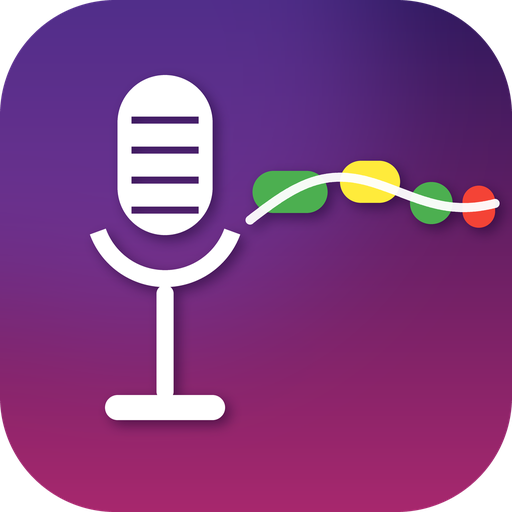
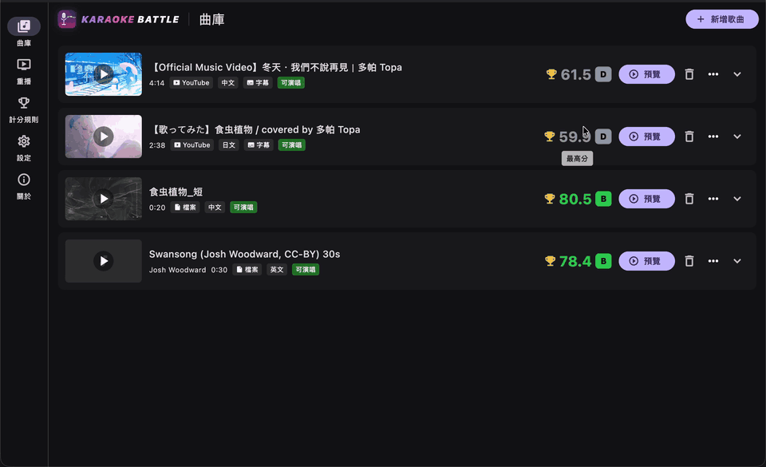
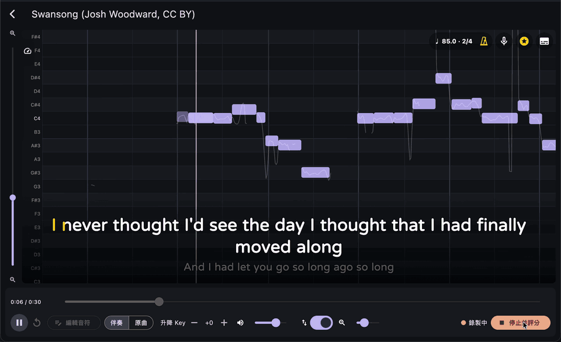
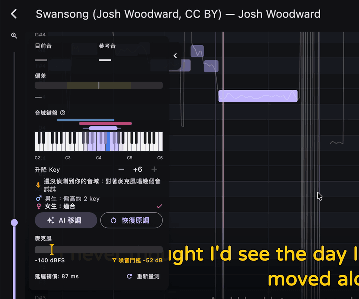
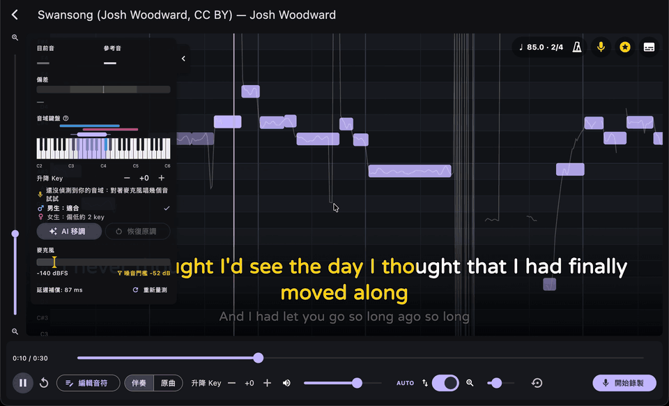
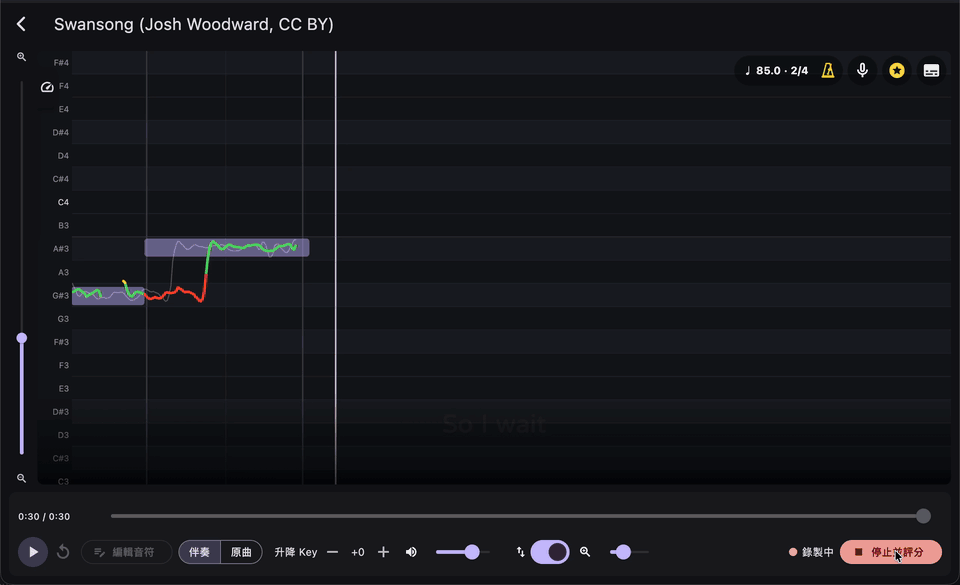
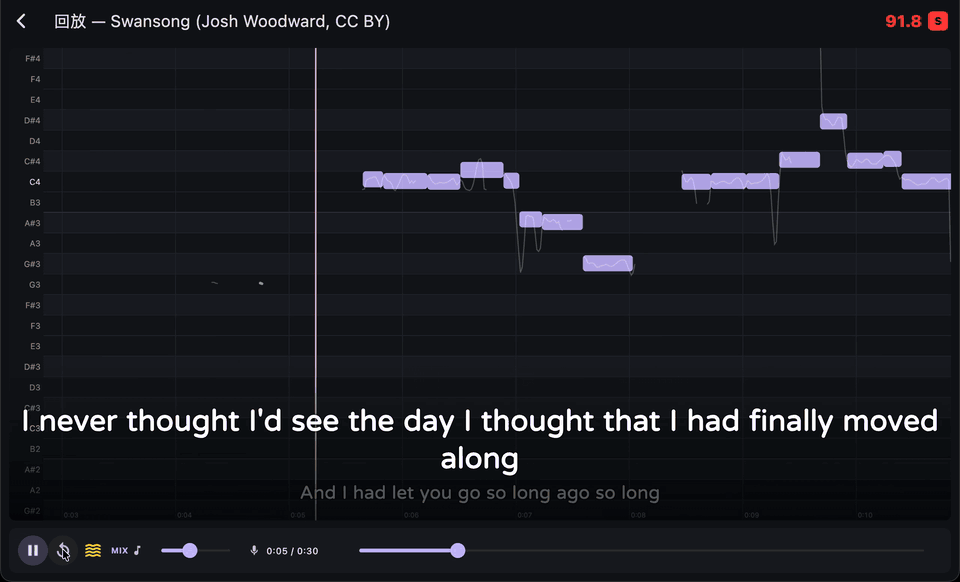
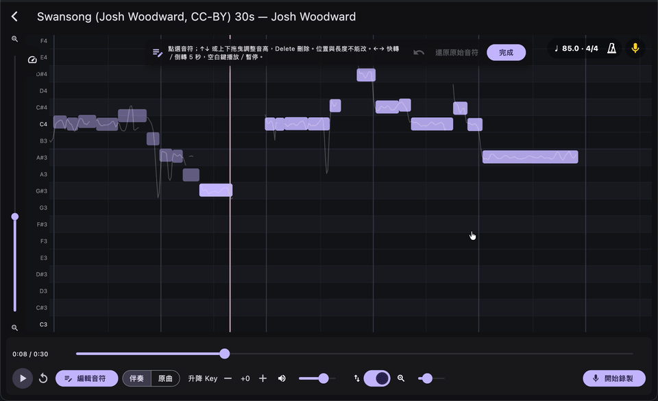
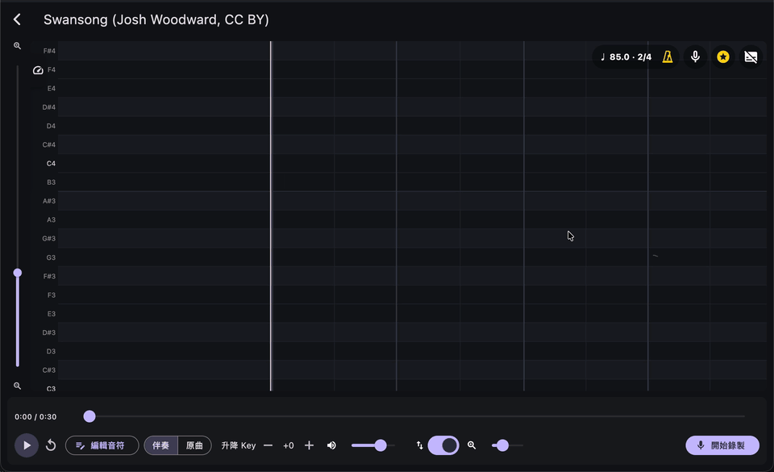
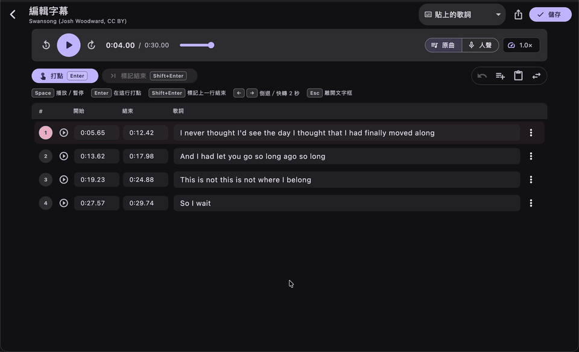

<p align="center">
  
</p>

<h1 align="center">Karaoke Battle</h1>

<p align="center">
  <a href="#ダウンロード"><picture><source media="(prefers-color-scheme: dark)" srcset="https://img.shields.io/badge/%E3%83%80%E3%82%A6%E3%83%B3%E3%83%AD%E3%83%BC%E3%83%89-macOS%20%7C%20Windows-2EA44F?style=for-the-badge"></picture></a>
  <br>
  <a href="https://github.com/Hikari-Tsai/karaoke-battle/releases/latest"></a>
  <a href="https://github.com/Hikari-Tsai/karaoke-battle/actions/workflows/build.yml"></a>
  <a href="LICENSE"></a>
</p>
<p align="center"><a href="README.md">中文</a> · <a href="README.en.md">English</a> · <b>日本語</b></p>

配信者向けのカラオケ採点システムです。YouTube のリンクを貼り付けるか動画・音声ファイルをドラッグ＆ドロップすると、アプリがローカルで
ボーカル分離、メロディの採譜、参照ピッチの抽出を行います。歌唱中はスクロール式のピアノロールに参照メロディとリアルタイムの
F0 曲線を表示し、歌い終わると音程、リズム、安定感、ビブラート、抑揚、ロングトーンに基づいて定量的なスコアを出します。

* macOS（Universal、Apple Silicon + Intel）と Windows x64 に対応した、Flutter デスクトップアプリ + C++ ネイティブエンジンです。
* すべてのモデルは初回実行時に Hugging Face の `aaatmy/*` からダウンロードされ、SHA-256 で検証されます。インストーラーにモデルは含まれません。起動のたびにモデルがそろっているか確認し、足りない・壊れている場合はダウンロードし直してからライブラリに入ります。
* Windows では CUDA を主な高速化経路としています（自動検出し、不足している場合はドライバーのインストールを案内して CUDA ランタイムをダウンロードします）。
  フォールバックは DirectML と CPU です。macOS は CPU を使用します（一部のモデルでは CoreML を試行します）。フォールバックは採点の精度には影響せず、曲の準備の速度にのみ影響します。

## ダウンロード

<p align="center">
  <a href="https://github.com/Hikari-Tsai/karaoke-battle/releases/latest/download/KaraokeBattle-macos-universal.dmg"><picture><source media="(prefers-color-scheme: dark)" srcset="https://img.shields.io/badge/macOS-Apple%20Silicon%20%2B%20Intel-F2F2F2?style=for-the-badge&logo=apple&logoColor=black&labelColor=D9D9D9"></picture></a>
  &nbsp;
  <a href="https://github.com/Hikari-Tsai/karaoke-battle/releases/latest/download/KaraokeBattle-windows-x64.zip"><picture><source media="(prefers-color-scheme: dark)" srcset="https://img.shields.io/badge/Windows-10%20%2F%2011%20x64-0078D4?style=for-the-badge&labelColor=005A9E&logo=data:image/svg%2bxml;base64%2CPHN2ZyB4bWxucz0iaHR0cDovL3d3dy53My5vcmcvMjAwMC9zdmciIHZpZXdCb3g9IjAgMCAyNCAyNCIgZmlsbD0id2hpdGUiPjxwYXRoIGQ9Ik0wIDBoMTEuMnYxMS4ySDB6TTEyLjggMEgyNHYxMS4ySDEyLjh6TTAgMTIuOGgxMS4yVjI0SDB6TTEyLjggMTIuOEgyNFYyNEgxMi44eiIvPjwvc3ZnPg=="></picture></a>
</p>

<p align="center">無料・オープンソース（MIT）· <a href="docs/INSTALL.md">インストール手順</a> · <a href="https://github.com/Hikari-Tsai/karaoke-battle/releases">すべてのバージョンと更新履歴</a></p>

<p align="center"><sub>macOS：DMG を開いてアプリを「アプリケーション」へドラッグ。初回はアプリを右クリック →「開く」。<br>Windows：解凍して <code>karaoke_battle.exe</code> を実行。初回起動時にモデル（約 500 MB）を自動でダウンロードします。</sub></p>

## 配信者向けの機能

以下はすべて実際にアプリを操作して録画した画面です（デモ曲は Josh Woodward の「Swansong」、CC BY）。GIF に音声はありません。

### どんな曲もカラオケに

YouTube のリンクを貼るか動画・音声ファイルをドロップするだけ。アプリがバックグラウンドでボーカルを分離して伴奏を作り、メロディの音符と基準ピッチを書き起こします。終わればすぐ歌えます。複数の曲をまとめて準備することもできます。

<p align="center"></p>

### どの音を外したかがすぐわかる

スクロールするピアノロールに原曲の音符がすべて表示され、自分の音程がリアルタイムに線で描かれます。緑は正確、黄色は惜しい、赤は外れ。視聴者にもひと目で伝わります。歌った音ごとに音ゲーのような PERFECT／GREAT／GOOD／MISS の判定も表示されます（右上の星ボタンでオフにできます）。

<p align="center"></p>

### AI 音域キーボードとワンクリック移調

ダッシュボードのピアノ鍵盤に曲の音域がそのまま塗られ、男性・女性の歌いやすい音域と並べて、このキーが誰向きか、高いか低いかを教えてくれます。録音前でもマイクに向かって何音か歌えば、出せた音に鍵盤上でオレンジの点が付き、自分の音域と曲の音域をすぐ見比べられます。「AI 移調」で男性か女性を選ぶと、伴奏・音符・鍵盤がそろって合うキーへ移ります。録音中は楽譜の音（青）と歌っている音（オレンジ）がリアルタイムに光ります。

<p align="center"></p>

### キー変更とボーカルリターン

キーを変えると伴奏と基準の音符が一緒に移調されます（録音中はロックされ、1 回の録音は 1 つのキーです）。右上のボーカルリターンで自分の声を音楽と一緒にヘッドホンへ返せます（OBS でアプリの音声をキャプチャすれば配信にも声が乗ります）。ホールリバーブも掛けられます。

<p align="center"></p>

### スコアとシェアカード

歌い終わるとすぐ、0〜100 点の総合得点、D〜SSS のランク、6 項目のサブスコアが出ます。音程とリズムが合っていれば 80 点前後、S（91 点以上）には音程もリズムも安定した歌唱が必要で、歌詞の間違いは減点されません。ワンクリックでシェア用のカードにして X、Instagram、Threads に投稿できます。各サブスコアの ⓘ で採点方法と上達のコツを確認できます。MV を背景に、スクロールする音符・自分の音程ライン・歌詞・判定を重ね、最後に得点を表示する 1080p の歌唱動画も書き出せます。歌った記録はすべてライブラリに残り、最高点もひと目でわかります。

<p align="center"></p>

### 音ゲー風の判定表示

歌唱中もリプレイでも、音ゲーのように再生位置で PERFECT／GREAT／GOOD／MISS の判定が表示されます。歌唱中の判定はタイミングだけを見るので歌い出した瞬間に表示され、FAST／LATE のタグが付きます。リプレイではタイミングと音程の両方を見て HIGH／LOW も付くので、早い・遅い・高い・低いがひと目で分かります。リプレイは zip（採点データと歌声の録音）に書き出して友達に送れ、相手は読み込むだけであなたの歌唱を見られます。リプレイではリバーブのオン・オフや量をその場で変えられ、MIX スライダーで声と音楽のバランスを調整できます。

<p align="center"></p>

### 音符を手で直せる

「音符を編集」を押し、音符を上下にドラッグすれば直せます。ドラッグ中は正弦波で音程を試聴できます（GIF では聞こえません）。いつでも自動採譜の結果に戻せます。

<p align="center"></p>

### 歌詞の読み込みと編集

YouTube の動画に字幕があればそのまま歌詞になり、丸ゴシック体（jf open 粉圓）で表示します。中国語、かな、英語のどれも読みやすい書体です。字幕がない動画やローカルファイルでは、次から選べます。

* **字幕ファイルを読み込む**：SRT・VTT・LRC。
* **歌詞を貼り付け（AI 同期）**：1 曲分を貼り付けると自動でタイミングを合わせます。既定では曲の準備で取り出した音符を使い（数秒で完了）、「AI で聞き取り」を選ぶと歌詞を聞き取ってから合わせます。
* **AI で字幕を作成**：OpenAI Whisper 音声認識。歌唱言語は自動判定、手動指定も可。モデルは初回使用時に確認してからダウンロードします（Windows は約 6.2 GB で GPU 実行、Mac は int8 版約 1.8 GB で CPU 実行）。
* **自分で入力**。

<p align="center"></p>

プレビューの歌詞ボタンにも同じ項目があり、◀ ▶ で字幕を早めたり遅らせたりできます（二重矢印は 0.5 秒）。曲メニューの「歌詞を編集…」では文字と時間を 1 行ずつ直せます。再生しながら各行の頭で Enter を押して打点するほか、全体をずらす、行の分割・結合、SRT・LRC での書き出しもできます。元の YouTube 字幕は残るので、いつでも戻せます。

<p align="center"></p>

### 人気曲

左の「人気曲」タブでは、ホリデイKTV・銭櫃（キャッシュボックス）・JOYSOUND・DAM の公式サイトから週間ランキングを、KKBOX から週間シングルランキングを取得します。言語やジャンル（北京語、台湾語、広東語、アニメ、ボカロ…）を切り替えて、順位・曲名・歌手・選曲番号・集計期間を表示し、台湾の 2 社と KKBOX は前週からの順位変動も表示します（KKBOX はストリーミングのランキングなので選曲番号はありません）。何を歌うか迷ったときに便利です。結果は 6 時間保持され、手動で再読み込みもできます。各ソースは画面上部のタブで切り替えられ、各タブの最後に公式サイトのランキングへのリンクがあります。各曲には「YouTube で検索」ボタンもあります。

## アーキテクチャ

詳細は [docs/ARCHITECTURE.md](docs/ARCHITECTURE.md)（英語）、[docs/BACKENDS.md](docs/BACKENDS.md)（英語）、[docs/BUILD.md](docs/BUILD.md)（英語）をご覧ください。

| レイヤー | 内容 |
| --- | --- |
| `app/` | Flutter UI：曲ライブラリ、曲の準備パイプライン、歌唱画面（スクロール MIDI + リアルタイム F0）、結果、設定；Dart 採点モジュール |
| `engine/` | C++17 エンジン（dart:ffi）：ONNX Runtime の動的ロード、MDX-Net 分離、GAME 採譜、SwiftF0 ピッチ、miniaudio によるリアルタイム音声と再生クロック、signalsmith-stretch によるキー変更 |
| `scripts/` | ORT、sidecar（yt-dlp / ffmpeg / deno）、CUDA pack のバージョン一覧とダウンロードスクリプト |
| `.github/workflows/` | macOS universal と Windows の CI パッケージング |

## モデル

| モデル | 用途 | 作者 | ライセンス |
| --- | --- | --- | --- |
| [aaatmy/game-large-onnx](https://huggingface.co/aaatmy/game-large-onnx) / [game-small-onnx](https://huggingface.co/aaatmy/game-small-onnx) | ボーカルの MIDI 変換（GAME 1.0 Large / Small） | Team OpenVPI | 重み CC BY-NC-SA 4.0（非商用）、コード MIT |
| [aaatmy/uvr-mdx-net-onnx](https://huggingface.co/aaatmy/uvr-mdx-net-onnx) | ボーカル分離 Kim_Vocal_2 | KimberleyJensen（UVR 経由で配布） | ライセンスファイルなし；作者による公開の許諾表明 |
| 同上 | 伴奏分離 UVR-MDX-NET-Inst_HQ_4 | UVR コア開発者 Anjok07、aufr33 | MIT（UVR の表記に準拠） |
| [aaatmy/swift-f0-onnx](https://huggingface.co/aaatmy/swift-f0-onnx) | リアルタイム・オフライン F0 | Lars Nieradzik | MIT |
| [aaatmy/beat-this-onnx](https://huggingface.co/aaatmy/beat-this-onnx) | 拍・小節頭・BPM（拍線、メトロノーム） | CPJKU（Foscarin、Schlüter、Widmer） | MIT |
| [aaatmy/kuromoji-ipadic-pack](https://huggingface.co/aaatmy/kuromoji-ipadic-pack) | 日本語歌詞のローマ字表記（日本語歌詞がある場合のみダウンロード） | kuromoji.js（Takuya Asano）、mecab-ipadic（NAIST） | Apache-2.0、IPADIC 条項 |
| [aaatmy/whisper-large-v3-onnx](https://huggingface.co/aaatmy/whisper-large-v3-onnx) | 字幕のない曲の歌詞認識と、貼り付けた歌詞のタイミング合わせ（Whisper large-v3、任意、初回使用時にダウンロード） | OpenAI | Apache-2.0 |

GAME・MDX-Net・SwiftF0 のミラーは上流の公式ファイルをそのままコピーしたもので（再学習・量子化・再エクスポートは行っていません）、manifest と SHA-256 を追加しているだけです。Whisper のミラーは onnx-community による openai/whisper-large-v3 の ONNX エクスポート（int8 量子化版を含む）をそのままコピーしたものです。
GAME の重みは非商用ライセンスのため、アプリ全体の利用もその条項の制約を受けます。

## 採点

歌唱終了後、録音した F0 曲線を原曲の歌声（GAME の音符と SwiftF0 の参照曲線）と整列させて比較し、6 項目のサブスコアを算出します：
**音程**（Raw Chroma Accuracy）、**リズム**（音ゲーのように音符ごとに PERFECT／GREAT／GOOD／MISS を判定、判定幅は BPM で拡縮）、**安定感**、
**ビブラート**、**抑揚**（エネルギー曲線の相関）、**ロングトーン**。これらの加重合計を 0〜100 点に換算し、D〜SSS のランクを出します。音程とリズムが合っていれば 80 点前後、上手なら 85 点以上、S（91 点以上）には音程もリズムも安定した歌唱が必要です。歌詞は認識しないので、歌詞の間違いや忘れた部分をハミングしても減点されません。採点ルールが変わったときは、過去の録音を保存済みの音高から自動で再採点するので、新旧の点数をそのまま比べられます。

歌唱中の判定は遅延を短くするためタイミングだけを見て（FAST／LATE）、リプレイの判定はタイミングと音程の両方を見ます（HIGH／LOW も付きます）。表示のみで、点数は歌い終わった後に録音全体から採点した結果です。

設計上のポイントは三つです：**オクターブ違いは同じ音とみなす**（1 オクターブ上や下で歌っても正解）、**全体の移調を許容する**
（全曲で一つの半音シフト量のみを使用し、自動推定）、そして**原曲歌唱のポルタメントと GAME の採譜誤差を許容する**ことです。各 frame
の目標には原曲の F0 曲線と GAME の音符ピッチの両方があり、どちらかに合っていれば正解とします。原曲に合わせて音を滑らせても、音をまっすぐ歌っても構いません。
整列手法、指標の定義、数式、キャリブレーション結果の詳細は [docs/SCORING.ja.md](docs/SCORING.ja.md) をご覧ください。

## インストールと使い方

上の「[ダウンロード](#ダウンロード)」から DMG または zip をダウンロードしてインストールしてください。macOS では初回、アプリを右クリックして「開く」を選んでください（未公証のため）。Windows では SmartScreen で「実行」を選んでください。
初回起動時にモデル（約 500 MB）と外部ツールをダウンロードします。Windows では CUDA ランタイムのダウンロードも選択できます。
曲を追加（YouTube リンクまたはファイルのドラッグ＆ドロップ）したら曲の準備が終わるまで待ち、「プレビュー」を押して歌唱画面に入ります。先に原曲や伴奏を聴きながらピアノロールを確認でき、ヘッドホンを着けて「録音開始」を押すと採点が始まります。歌唱画面右上のマイクボタンを押すとパネルが開き、ボーカルリターンをオンにすると自分の声が音楽と一緒に出力されます。同じパネルでホールリバーブのオン／オフとミックスを調整でき、リプレイにも適用されます。隣の星ボタンでリアルタイム判定のオン／オフを切り替えられます（初期設定はオン）。新しいバージョンが出ると、左のナビゲーション下部の「このアプリについて」に吹き出しが表示されます。録音・採点・書き出したリプレイファイルは常にドライの声を使います。採点が完了しなかった場合は、ライブラリで曲を展開し、歌唱記録の横の「採点する」を押すと採点し直せます。
手順の詳細、データの保存場所、よくある質問は [docs/INSTALL.md](docs/INSTALL.md)（中国語）をご覧ください。

## ビルド

```bash
# エンジン（macOS、universal）
scripts/fetch_ort.sh
cmake -S engine -B engine/build -G Ninja -DCMAKE_BUILD_TYPE=Release
cmake --build engine/build -j

# App
cd app && flutter pub get && flutter run -d macos
```

開発モードでは、アプリが自動的に `engine/build/` からエンジンを、`engine/third_party/onnxruntime/` から ORT を探します。

## 問題の報告と協力

いちばん大事なテストは配信で実際に使うことです。問題があればアプリ左側のナビゲーションの一番下にある「問題を報告」を押すか、[Issues](https://github.com/Hikari-Tsai/karaoke-battle/issues) に報告してください。報告に書く内容やコードでの貢献については [CONTRIBUTING.ja.md](CONTRIBUTING.ja.md) を参照してください。

## 謝辞

### 早期テスター

正式版の前にテストに参加し、問題を報告してくれた配信者と仲間の皆さんに感謝します。

* **天櫻咲樂**：50XX シリーズの GPU でテスト。GPU のテンソル演算のバグ、CPU／GPU 切り替えのバグ、録画時の字幕カードのバグを発見。編集モードの UI と採点アルゴリズムを提案し、ランキングのアイデアをくれました。配信での実地テスト。
* **多帕**：yt-dlp のエラーを発見。30XX と 50XX シリーズの GPU でテスト。採点アルゴリズムとハイスコア更新タイミングを提案し、歌詞の自動アライメントのアイデアをくれました。配信での実地テスト。
* **可樂月月**：歌詞の In／Out の提案と改善、歌詞の手動読み込み機能の追加、Whisper による歌詞起こしのアイデア。処理中にキャンセルするとフリーズするバグと、曲ごとの音量差を発見。
* **妮亞露**：30XX シリーズの GPU でテスト。一部の曲で準備が止まってしまう問題、録音時の体感遅延、「もう一度歌う」で設定がリセットされる問題を発見。歌詞を読み込むときに出典を示す、削除時に完全削除を確認する、ダウンロード失敗時に「再ダウンロード」ボタンを表に出す、というアイデアをくれました。ダウンロードした曲どうしの音量差が大きいことを発見し、バックグラウンドでのマスタリング処理を提案。
* **貝拉子**：FFmpeg のダウンロード先のバージョンとパスの問題を発見。
* **東爺**：パスに中国語の文字があると動かないバグを発見。

### モデルとライブラリ

引用形式の全文（BibTeX を含む）と各上流の要件は [docs/CITATIONS.md](docs/CITATIONS.md)（中国語）をご覧ください。

* **GAME 1.0 Small / Large**（メロディ採譜モデル）by **Team OpenVPI**、
  出典 [openvpi/GAME v1.0.3](https://github.com/openvpi/GAME/releases/tag/v1.0.3)、
  ライセンス [CC BY-NC-SA 4.0](https://creativecommons.org/licenses/by-nc-sa/4.0/)。
  モデルは yqzhishen が公開し、データのアノテーションは 挚彬Club、YQ之神、小狼、幽寂 が提供しました。本アプリは公式の ONNX ファイルを改変せずに使用しています。openvpi による承認を受けたものではありません。
* **Kim_Vocal_2**（ボーカル分離）by **KimberleyJensen**。独自に学習され、UVR 経由で配布されています。上流にライセンスファイルはなく、作者の
  [公開の許諾表明](https://github.com/KimberleyJensen/kmdx-net_music-source-separation/issues/3)（2026-10-02）に基づいて使用しています。
* **UVR-MDX-NET-Inst_HQ_4**（伴奏分離）by **Ultimate Vocal Remover** コア開発者 **Anjok07 と aufr33**（MIT、UVR のクレジット表記要件に従っています）。
* MDX-Net のアーキテクチャと学習コードは **kuielab** によるものです（Choi et al., *TFC-TDF-U-Net*, ISMIR 2020；Kim et al., *KUIELab-MDX-Net*, MDX Workshop @ ISMIR 2021）。
  エンジンの分離コードは [python-audio-separator](https://github.com/nomadkaraoke/python-audio-separator)（MIT）から移植しました。
* **SwiftF0** by Lars Nieradzik（*SwiftF0: Fast and Accurate Monophonic Pitch Detection*, arXiv:2508.18440, 2025）。
* 採点指標の定義は **mir_eval**（Raffel et al., ISMIR 2014）とメロディ抽出の評価に関する文献（Poliner et al. 2007；Salamon et al. 2014）に基づいています。
  リアルタイムのピッチ追跡には **MPM**（McLeod & Wyvill, ICMC 2005）を、整列には Sakoe-Chiba バンド付き DTW（1978）を使用しています。
* キー変更には [Signalsmith Stretch](https://github.com/Signalsmith-Audio/signalsmith-stretch)、音声 I/O には miniaudio、推論には ONNX Runtime を使用しています。
* 歌詞認識には **OpenAI Whisper** large-v3（Radford et al., *Robust Speech Recognition via Large-Scale Weak Supervision*, ICML 2023）を使用しています。ONNX は onnx-community によるエクスポートです。
* 歌詞の書体は justfont の [jf open 粉圓](https://github.com/justfont/open-huninn-font)（SIL OFL 1.1）です。
* ボーカルのリバーブには Ghost Note Audio の [Cloud Seed](https://github.com/GhostNoteAudio/CloudSeedCore) アルゴリズム（MIT）を使用しています。本プロジェクトは Ghost Note Audio とは無関係です。

## 法的事項

本アプリに組み込まれた yt-dlp による動画・音声のダウンロードは、ユーザーがローカルで個人的に利用する目的に限ります。YouTube コンテンツのダウンロードは
YouTube の利用規約に違反する可能性があり、その責任はユーザー自身が負うものとします。アプリが楽曲データをアップロードまたは配布することはありません。

人気曲タブのデータは各カラオケ事業者の公式サイト（ホリデイKTV、銭櫃、JOYSOUND、DAM）と KKBOX のランキングから取得しており、データと商標は各社に帰属します。本プロジェクトはこれらの事業者とは無関係です。データは各サイトのフロントエンドが使う非公開のインターフェースから読み取っているため、サイトの変更によって使えなくなることがあります。

## ライセンス

コードは MIT ライセンスです。[LICENSE](LICENSE) をご覧ください。サードパーティのコンポーネントについては [THIRD_PARTY_NOTICES.md](THIRD_PARTY_NOTICES.md) をご覧ください。
